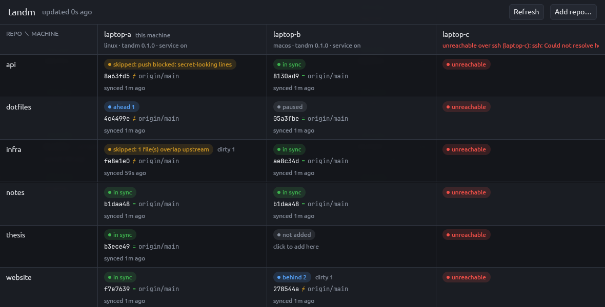

# tandm

Keeps git-synced repos in step across your machines, and shows their sync state in one grid:
**machines as columns, repos as rows**.



Each machine runs a small headless engine every 2 minutes (systemd user timer on Linux, launchd
agent on macOS). The engine pulls new commits from `origin/main` and pushes commits that people
made locally. It's built for worktrees that several people or AI agent sessions edit at once, so
it is deliberately timid:

- **never commits, never stashes by hand, never force-pushes**;
- syncs only the configured branch (default `main`), and only while it's checked out;
- skips while a merge, rebase, cherry-pick or revert is in progress, or while `index.lock` exists;
- when behind it fast-forwards; when diverged it rebases local commits onto upstream (with
  autostash);
- skips the pull when uncommitted or untracked files overlap files that upstream changed;
- if a rebase conflicts, aborts it and leaves everything as it was;
- refuses to push when an outgoing commit adds secret-looking lines (private keys, mongodb URIs with
  passwords, `*KEY/SECRET/TOKEN/PASSWORD*=` long values);
- runs one sync per repo at a time; ssh is non-interactive (`BatchMode=yes`, 15 s connect timeout).

It started as a port of a bash script (`git-autosync.sh`) that did the same for one checkout from
a timer. The behaviour is ported from that script, with a few deliberate differences (see [PLAN.md](PLAN.md#sync-engine-port-of-the-script)).

## Install

Requires git, and Rust ≥ 1.89 to build.

```sh
git clone <this repo> ~/projects/tandm && cd ~/projects/tandm

# Linux (throttle on a busy box), installs to ~/.local/bin/tandm
nice -n 15 cargo install --locked --path crates/tandm --root ~/.local -j 4

# macOS (needs Xcode; the Metal shader compiler isn't required)
cargo install --locked --path crates/tandm --root ~/.local
```

Install it in the same place on every machine. Peers run `tandm` over ssh, and the non-interactive
ssh `PATH` is minimal on some machines. On Arch, for example, it is only
`/usr/local/sbin:/usr/local/bin:/usr/bin`, so peers reach it as `~/.local/bin/tandm`:
`tandm machine add arch-box --tandm '~/.local/bin/tandm'` (or `tandm = "…"` in the config).
On macOS, `~/.local/bin` is on that `PATH`, so plain `tandm` works.

To build only the CLI and engine (no GPU libraries), add `--no-default-features`.

**Linux GUI:** gpui 0.2.2 renders with Vulkan. You need a Vulkan driver (`vulkan-intel`,
`vulkan-radeon` or `vulkan-swrast` on Arch), not just `vulkan-icd-loader`. The CLI and the service
don't need one.

## Set up a machine

```sh
tandm add ~/projects/notes               # start syncing a checkout (row name = dir name)
tandm machine add laptop-b                # a peer, by ssh alias
# from laptop-b: tandm machine add laptop-a [--tandm '~/.local/bin/tandm']
tandm service install                     # sync every 2 min in the background
tandm app install                         # optional: open the grid from Finder/Spotlight/Dock or the app launcher
tandm status --all                        # this machine + peers
```

`tandm app install` makes `~/Applications/tandm.app` on macOS. Its executable is a symlink to the
installed binary, so a new build updates the app too; after a version bump re-run it to refresh the
version shown in Finder. On Linux it writes `~/.local/share/applications/tandm.desktop` and an icon,
so tandm shows up in the launcher (Omarchy: Super+Space). Run it from the installed binary, not from
`target/`.

Do the same on each machine, adding the *other* machines as peers. Peers are reached with
`ssh -o BatchMode=yes <alias> tandm status --json`, so ssh between them must work without a
prompt (an ssh key plus an alias in `~/.ssh/config`; a VPN like Tailscale makes this easy). tandm opens no ports and runs no daemon.

## Use

```
tandm add <path> [--name N] [--branch main] [--remote origin]
tandm rm <repo>                 # stop syncing (the checkout is untouched)
tandm list
tandm status [--json] [--all]   # --all adds peers over ssh
tandm sync [repo]               # sync now (all unpaused repos without an argument)
tandm pause <repo> / resume <repo>
tandm log <repo> [-n 30]
tandm machine add <name> [--ssh dest] [--tandm cmd] / machine rm <name> / machine list
tandm service install | uninstall | status
tandm gui                       # the window, from a terminal
tandm app install | uninstall   # the window as an app (tandm.app / .desktop entry)

tandm --on <machine> <command…>   # run any of the above on a peer over ssh, e.g.
tandm --on laptop-b sync notes
tandm --on laptop-b add '~/projects/x'   # quote ~ so it expands on the peer, not here
```

The interval and a repo's branch/remote have no command: edit `config.toml` (after changing
`interval_secs`, re-run `tandm service install`).

The same state from a terminal (the demo in the screenshot above):

```
$ tandm status --all
laptop-a (this machine) — linux · tandm 0.1.0 · service active
  notes     in sync         b1daa48 = origin/main  last run 1m ago: in sync
  website   in sync         f7e7639 = origin/main  last run 1m ago: pushed 2 commit(s) -> f7e7639
  infra     skipped: 1 file(s) overlap upstream  fe8e1e0 ≠ origin/main  dirty 1  last run 1m ago: skip pull: uncommitted changes overlap upstream: main.tf
  api       skipped: push blocked: secret-looking lines  8a63fd5 ≠ origin/main  last run 1m ago: NOT pushing 1 commit(s): secret-looking lines: .env.example:1 (credential assignment) in 8a63fd58
  dotfiles  ahead 1         4c4499e ≠ origin/main  last run 1m ago: in sync
  thesis    in sync         b3ece49 = origin/main  last run 1m ago: in sync

laptop-b — macos · tandm 0.1.0 · service active
  notes     in sync         b1daa48 = origin/main  last run 1m ago: in sync
  website   behind 2        278544a ≠ origin/main  dirty 1  last run 1m ago: in sync
  infra     in sync         ae8c34d = origin/main  last run 1m ago: pulled 1 commit(s) -> ae8c34d
  api       in sync         8130ad9 = origin/main  last run 1m ago: in sync
  dotfiles  paused          05a3fbe = origin/main  last run 1m ago: in sync

laptop-c: unreachable — unreachable over ssh (laptop-c): ssh: Could not resolve hostname laptop-c: Name or service not known
```

`tandm sync` exits non-zero in the cases the old script did: an error, a rebase conflict, or a push
blocked by the secret check.

### The grid (`tandm gui`)

Each cell shows that repo's state on that machine: *in sync*, *ahead N*, *behind N*, *diverged*,
*skipped: reason*, *error*, *paused*, *unreachable* or *not added*. It also shows a *dirty N* badge,
the short HEAD with `=`/`≠` for "matches `origin/main`", and when it last synced. Click a cell for
details (paths, full SHAs, overlap files, secret hits as `file:line`, git's error output, log tail)
and for actions: **Sync now**, **Pause/Resume**, **Remove from this machine**. Click an empty cell to
add that repo on that machine; the path is pre-filled from another machine. **Add repo…** adds any
path on any machine. Refresh: button, Ctrl/⌘-R or F5. Status refreshes every 30 s on its own.

## Files

| | Linux / macOS |
|---|---|
| config | `~/.config/tandm/config.toml` (or `$XDG_CONFIG_HOME/tandm`) |
| per-repo state | `~/.local/state/tandm/<repo>.json`, `.log`, `.lock` (or `$XDG_STATE_HOME/tandm`) |
| service | `~/.config/systemd/user/tandm.{service,timer}` / `~/Library/LaunchAgents/local.tandm.sync.plist` |
| macOS service output | `~/.local/state/tandm/service.log` |

`TANDM_CONFIG_DIR` / `TANDM_STATE_DIR` override the first two (handy for experiments).

```toml
interval_secs = 120

[[repo]]
name = "notes"
path = "/home/alice/projects/notes"
branch = "main"      # default
remote = "origin"    # default
# paused = true

[[machine]]
name = "laptop-b"
# ssh = "laptop-b"                  # default: name
# tandm = "~/.local/bin/tandm"      # default: tandm
```

The log records only actions and changes of state, e.g.:

```
2026-11-01 14:02:11 pulled 2 commit(s) -> 71be7f1
2026-11-01 14:20:13 skip pull: uncommitted changes overlap upstream: docs/setup.md
2026-11-01 14:24:13 ok again (was: skip pull: uncommitted changes overlap upstream: docs/setup.md)
2026-11-01 14:24:14 pushed 1 commit(s) -> 9a0c3e2
```

## Develop

```sh
cargo test -p tandm-core            # engine safety tests against real temp git repos; no GPU deps
cargo run -p tandm -- status        # CLI
cargo run -p tandm -- gui           # window
```

Layout: `crates/tandm-core` (engine, config, status, ssh, service), `crates/tandm-gui` (GPUI),
`crates/tandm` (the binary). Design notes are in [PLAN.md](PLAN.md).

Not done yet: Windows service support (the engine and CLI should work; `service install` says it's
unsupported).
